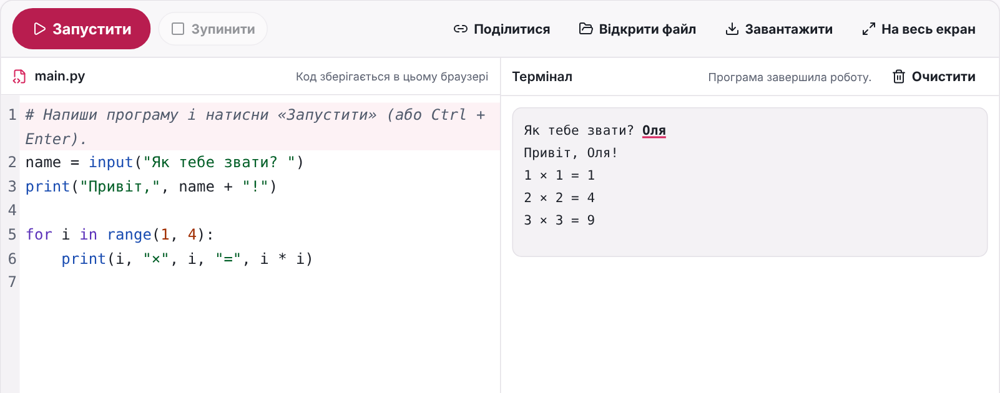
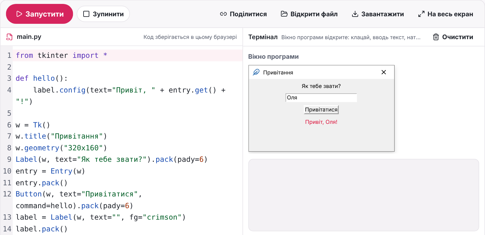
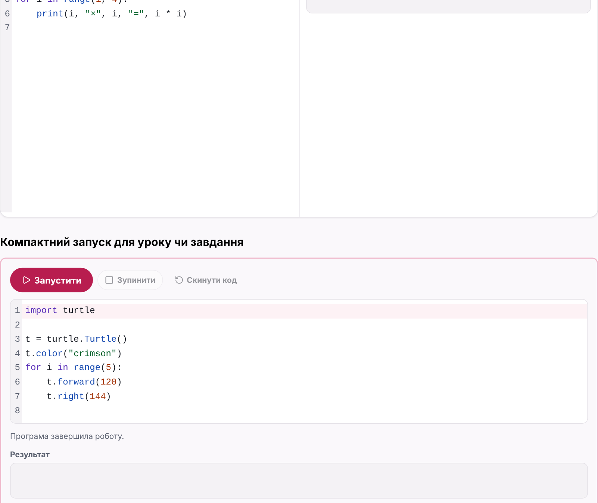

<h1 align="center">edu-python</h1>

<p align="center">
  <b>A Python online IDE for school: MicroPython in the browser with <code>input()</code>, turtle, tkinter windows and error explanations in Ukrainian.</b><br>
  An editor and a terminal for lessons, homework and practical works, plus the same engine for server-side checks. Made for computer science lessons in grades 5–9.
</p>

<p align="center">
  <a href="https://github.com/zavada123/edu-python/actions/workflows/pages.yml"></a>
  <a href="https://zavada123.github.io/edu-python/"></a>
  <a href="LICENSE"></a>
  
  
  
  
</p>

<p align="center">
  <a href="https://zavada123.github.io/edu-python/"><b>Live demo</b></a> ·
  <a href="https://github.com/zavada123/edu-python/actions/workflows/pages.yml"><b>CI &amp; deploys</b></a> ·
  <a href="#installation">Installation</a> ·
  <a href="#usage">Usage</a> ·
  <a href="#api">API</a>
</p>

<p align="center">
  <a href="https://zavada123.github.io/edu-python/"></a>
</p>

## Why

Students write their first programs on phones and old school computers. A server sandbox for every run is slow and costly, and Pyodide is heavy (about 6 MB). `edu-python` runs [MicroPython](https://micropython.org) (WebAssembly, about 200 KB gzipped) in a Web Worker. The first run starts in less than 0.3 s on a slow phone, and the page works without network after the first load.

School programs need more than `print()`: they ask for values with `input()`, draw with `turtle` and open windows with `tkinter`. This package gives all three in the browser, explains errors in Ukrainian in the words of a teacher, and runs the same engine in Node, so a server can check a task with the same `turtle` and `tkinter`. It was built for [EduProstir](https://eduprostir.com), a Ukrainian learning platform.

## Features

- **Online IDE** (`PythonIde`), in the style of onlineide.pro: toolbar, file tab, editor and terminal side by side (stacked on phones), open and download `.py` files, full screen (Esc closes it), Ctrl + Enter runs.
- **Compact runner** (`PythonRunner`) for a lesson or a task: the editor grows with the code, "Скинути код" puts back the starter code.
- **`input()` in the terminal**, as in IDLE. The worker cannot wait for a value without `SharedArrayBuffer` (COOP/COEP headers on every page), so a program that asks for a value stops and runs again with all values, with the same `random` seed. The student sees one continuous run.
- **Types in the terminal**: `print` shows strings, numbers and `True` / `False` / `None` in the colors of the editor, so `print("10", 10)` shows a string and a number. The text of the output does not change (task checks compare the same text).
- **turtle** with the names and the geometry of CPython `turtle` (`forward`, `circle` with `extent` and `steps`, `begin_fill`, `write` with a font, `speed`, `bgcolor`, `shape`…), animated frame by frame on a 600 × 600 canvas. `position()` and `heading()` work, because the state lives in Python.
- **tkinter**: `Tk`, `Toplevel`, `Label`, `Button`, `Entry`, `Text`, `Checkbutton`, `Radiobutton`, `Scale`, `Frame`, `LabelFrame`, `Canvas`, `StringVar` / `IntVar` / `DoubleVar` / `BooleanVar`, `pack` / `grid` / `place`, events (`bind`), `after()`, `messagebox` and `ttk`. Windows look like Windows windows in any page theme.
- **Errors in Ukrainian**: MicroPython often says only "invalid syntax". `explainError` finds the usual cause: no colon, a bracket or a quote not closed, `=` in a condition, no indent, smart quotes, Cyrillic letters in a Latin word, a typo in a known name ("Python не знає слова `pritn`. Можливо, мало бути `print`?"). The error line is red in the editor; the original message is under a fold.
- **Limits**: 5 s of work (waiting for `input()` does not count), 200 000 characters of output, a Stop button. A loop that never ends does not freeze the page: the worker is stopped.
- **Phones**: a symbol bar (`Tab ( ) : " ' = , + - * / < > [ ] # _`) on touch screens; smart quotes from a phone keyboard become plain quotes.
- **Share link**: the code goes in the fragment of the address (`#code=…`, base64url of UTF-8, up to 6 000 characters), which never reaches the server.
- **Server checks**: `runProgram` runs a program with the whole input known in advance and returns its output, a traceback, "needs more input" or "output limit".
- **Ukrainian UI**, keyboard friendly, WCAG AA colors for the code, light and dark page themes through CSS variables.

<p align="center">
  
  
</p>

## Installation

Install straight from GitHub and pin a commit. The built package is committed in `lib/`, so nothing is compiled on install.

```bash
npm install github:zavada123/edu-python#<commit>
```

MicroPython, CodeMirror and lucide-react are installed with the package (versions are pinned). Peer dependencies: `effect` 4.0.0-rc.117, and `react` with `react-dom` 19 or newer for `edu-python/react` (not needed for the engine in Node).

> The UI entry point brings CodeMirror, so load the page that uses it lazily with `React.lazy`.

## Usage

### 1. Add the worker file

Programs run in a Web Worker. The page makes its own worker file, so its bundler finds the `.wasm` of MicroPython:

```ts
// src/python-worker.ts
import wasmUrl from "@micropython/micropython-webassembly-pyscript/micropython.wasm?url"
import { startPythonWorker } from "edu-python/worker"

startPythonWorker(wasmUrl)
```

With Vite, the worker is a module worker (MicroPython uses top-level await), and MicroPython must stay out of dependency pre-bundling:

```ts
// vite.config.ts
export default defineConfig({
  worker: { format: "es" },
  optimizeDeps: { exclude: ["@micropython/micropython-webassembly-pyscript"] }
})
```

### 2. Render the Online IDE

```tsx
import { browserWorker } from "edu-python/core"
import { PythonIde } from "edu-python/react"
import "edu-python/style.css"

const worker = browserWorker(() => new Worker(new URL("./python-worker.ts", import.meta.url), { type: "module" }))

<PythonIde
  worker={worker}
  fileName="main.py"
  initialCode={localStorage.getItem("main.py") ?? 'print("Привіт!")'}
  onCodeChange={(code) => localStorage.setItem("main.py", code)}
  saveNote="Код зберігається в цьому браузері"
  actions={<ShareButton />}   // your buttons at the end of the toolbar, or null
  sidebar={<MyPrograms />}    // a panel left of the editor (a list of programs), or null
/>
```

The IDE does not store files itself: the page decides where the code lives (the browser, the account of a student) and gives a new `key` to open another program.

### 3. Or the compact runner in a lesson or a task

```tsx
import { type EditorHandle, PythonRunner } from "edu-python/react"

const editor = useRef<EditorHandle | null>(null)

<PythonRunner
  worker={worker}
  initialCode={draft ?? starterCode}  // a saved draft or the starter code
  resetCode={starterCode}             // what «Скинути код» puts back
  onCodeChange={(code) => saveDraft(code)}
  onEditorReady={(handle) => { editor.current = handle }} // e.g. to put a draft from the server in later
  note="Код збережено в кабінеті"     // short text at the end of the toolbar, or ""
/>
```

### Share link

```ts
import { shareFragmentOf, sharedCodeOf } from "edu-python/core"
import { Option } from "effect"

const link = Option.map(shareFragmentOf(code), (fragment) => `${location.origin}/ide#${fragment}`) // none if the code is too long
const shared = sharedCodeOf(location.hash) // Option<string>
```

### Check a program on the server

The engine runs in Node without a browser:

```ts
import { loadNodeEngine, runProgram } from "edu-python/engine"

const engine = await loadNodeEngine()
const result = runProgram(engine, "a = int(input())\nprint(a * 2)", "21\n", () => {})
// { _tag: "Finished", output: "42\n" }
// or { _tag: "Crashed", output, traceback } | { _tag: "NeedsInput", output } | { _tag: "OutputLimit" }
```

`runProgram` does not stop a program that never ends, and MicroPython can reach JavaScript (`import js`). Never run student code in the server process: run it in a child process with a time limit, an empty environment and the [Node permission model](https://nodejs.org/api/permissions.html) (`--permission`, read access only to the engine files, `--disallow-code-generation-from-strings`), and replace the first entry of the `proxy_js_ref` table with an empty object so that `import js` gives nothing. One process per submission keeps one student from changing `builtins` for another. EduProstir does it this way in `packages/python/src/sandbox.ts`.

### Theme

All colors are CSS variables on `.epy`. Set them on the page to use its own theme, also for a dark theme. A selector stronger than `.epy` wins even when `style.css` loads later:

```css
html .epy {
  --epy-primary: var(--primary);
  --epy-text: var(--foreground);
  --epy-card: var(--card);
}
```

| Variable | Used for |
|---|---|
| `--epy-primary`, `--epy-primary-hover`, `--epy-primary-text`, `--epy-primary-soft` | "Запустити", focus, the input field |
| `--epy-text`, `--epy-muted`, `--epy-muted-text` | Text, the terminal and the gutter, secondary text |
| `--epy-card`, `--epy-border`, `--epy-ring`, `--epy-radius` | Panels, borders, focus ring, corners |
| `--epy-danger`, `--epy-danger-soft`, `--epy-warning`, `--epy-warning-soft`, `--epy-info`, `--epy-info-soft` | Error, time limit and hint boxes |
| `--epy-font`, `--epy-font-mono` | Fonts of the UI and of the code |
| `--epy-code-keyword`, `--epy-code-string`, `--epy-code-number`, `--epy-code-comment`, `--epy-code-title` | Code colors (WCAG AA on `--epy-muted`) |
| `--tk-*` | tkinter windows (they keep their Windows look by default) |

## API

| Entry point | Contents |
|---|---|
| `edu-python/react` | `PythonIde`, `PythonRunner` and their parts: `CodeEditor`, `Console`, `Problem`, `SymbolBar`, `TkWindows`, `TurtleCanvas`, `usePythonRun` |
| `edu-python/core` | `browserWorker`, `createRunSession` (the run without React), `explainError`, `plainPunctuation`, `shareFragmentOf` / `sharedCodeOf`, `decodeScene`, the worker protocol, `inputLines`, `TestSeed`. No React and no engine |
| `edu-python/worker` | `startPythonWorker(wasmUrl)` for the worker file of the page |
| `edu-python/engine` | `loadEngine`, `loadNodeEngine`, `runProgram`, `silentSink`, the protocol and the Python texts of `turtle` and `tkinter` (`pythonLibrary`, `pythonPrelude`). For Node and for workers |
| `edu-python/style.css` | Styles of the components |

### `<PythonIde>` props

| Prop | Type | Description |
|---|---|---|
| `worker` | `WorkerFactory` | From `browserWorker(() => new Worker(...))`. A new worker starts for every run |
| `fileName` | `string` | Name on the file tab and of the downloaded file |
| `initialCode` | `string` | Code at the start. Change the component `key` to open another program |
| `onCodeChange` | `(code: string) => void` | Called after every change |
| `saveNote` | `string` | Where the code is kept, shown on the file tab |
| `actions` | `ReactNode` | Page buttons at the end of the toolbar (share, new program), or `null` |
| `sidebar` | `ReactNode` | A panel left of the editor (a list of programs), or `null` |

### `<PythonRunner>` props

| Prop | Type | Description |
|---|---|---|
| `worker` | `WorkerFactory` | As above |
| `initialCode` | `string` | Code at the start: a draft or the starter code |
| `resetCode` | `string` | Code that "Скинути код" puts back |
| `onCodeChange` | `(code: string) => void` | Called on the first render and after every change |
| `onEditorReady` | `(editor: EditorHandle) => void` | The editor handle: `setCode`, `insert`, `moveCursor`, `focus` |
| `note` | `string` | Short text at the end of the toolbar, `""` for none |

### Limits

| Constant | Value | What |
|---|---|---|
| `TimeLimitMs` | 5 000 | Work time of one run; waiting for `input()` or for a click in a window does not count |
| `MaxOutputChars` | 200 000 | Terminal output of one run |
| `MaxSceneChars` | 4 000 000 | One state of the tkinter windows (JSON) |
| `MAX_SHARED_CODE_LENGTH` | 6 000 | Code in a share link |

## Development

```bash
npm install
npm run dev        # demo: the Online IDE and the compact runner
npm test           # engine, turtle, tkinter, errors, session, share link (Node, the real MicroPython)
npm run typecheck
npm run build      # type check and build the demo into dist/
npm run build:lib  # build the package into lib/ (commit lib/ with your changes)
```

Project layout:

- `src/engine` — MicroPython loading, the worker protocol, `runProgram` and the Python texts in `py/` (`prelude.py`, `turtle.py`, `tkinter/`). No React and no page.
- `src/core` — the run session (limits, `input()` replay, Stop), error explanations, turtle and tkinter scenes, the share link and the worker code. No React.
- `src/ui` — the React components and `python.css`.
- `src/demo` — the demo page on GitHub Pages.
- `test` — tests with the real engine in Node.

Every push to `main` runs the tests and deploys the demo to GitHub Pages: see the [workflow runs](https://github.com/zavada123/edu-python/actions/workflows/pages.yml).

## Roadmap

- A few files in one project (`import` of a student module).
- `input()` without replay, when the page can send COOP/COEP headers (`SharedArrayBuffer`).
- More of `tkinter`: `Listbox`, `Spinbox`, `Menu`, images (`PhotoImage`). Now they give a clear error in Ukrainian.
- An English UI and error explanations.

## License

[MIT](LICENSE). MicroPython is licensed under MIT, CodeMirror under MIT, lucide under ISC.
